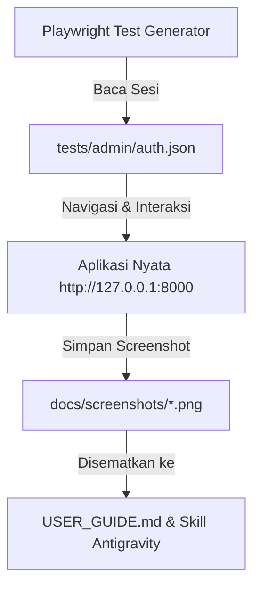

# Catatan Rencana Pembuatan User Guide Visual (NOTES User Guide)

**Dokumen**: Panduan Perancangan & Alur Tangkapan Layar Otomatis (Visual User Guide)  
**Aplikasi**: LaundryPro Management System  
**Framework Otomasi**: Playwright Test (TypeScript)  
**Tujuan**: Menyediakan panduan pengguna (User Guide) berbasis alur langkah demi langkah yang dilengkapi tangkapan layar (screenshot) beresolusi tinggi yang diambil secara otomatis dari aplikasi nyata.

---

## 1. Konsep & Metodologi Otomasi Screenshot

Alih-alih mengambil screenshot secara manual satu per satu, proses penangkapan layar dilakukan menggunakan **Playwright Test Runner**:



### Keunggulan Pendekatan Ini:
1. **100% Konsisten**: Ukuran viewport, posisi elemen, dan resolusi selalu identik (default `1280x720` atau `Desktop Chrome`).
2. **Dapat Diulang (Reproducible)**: Jika ada perubahan UI di masa mendatang, seluruh screenshot dapat diperbarui dalam hitungan detik hanya dengan satu perintah.
3. **Data Uji Bersih**: Form diisi dengan data contoh yang rapi dan profesional tanpa merusak data transaksi nyata.

---

## 2. Struktur Direktori Aset & Dokumentasi

```text
d:\laundry_playwright\
├── docs\
│   ├── screenshots\                     # Folder penyimpanan tangkapan layar otomatis
│   │   ├── 01_dashboard_admin.png
│   │   ├── 02_navigation_sidebar.png
│   │   ├── 03_daftar_order.png
│   │   ├── 04_pencarian_order.png
│   │   ├── 05_form_order_baru.png
│   │   ├── 06_input_pelanggan.png
│   │   ├── 07_keranjang_layanan.png
│   │   ├── 08_kalkulasi_total.png
│   │   ├── 09_order_berhasil_dibuat.png
│   │   ├── 10_modal_workflow_laundry.png
│   │   ├── 11_status_berhasil_diperbarui.png
│   │   ├── 12_modal_pembayaran.png
│   │   ├── 13_status_lunas.png
│   │   ├── 14_tombol_cetak_struk.png
│   │   ├── 15_tampilan_struk_thermal.png
│   │   ├── 16_daftar_layanan.png
│   │   └── 17_modal_tambah_layanan.png
│   └── USER_GUIDE.md                    # Dokumen panduan pengguna visual lengkap
├── .agents\
│   └── skills\
│       └── laundry-user-guide\          # Workspace Skill Antigravity
│           └── SKILL.md
└── NOTES_USER_GUIDE.md                  # Dokumen catatan rencana ini
```

---

## 3. Rincian Alur Penggunaan & Titik Pengambilan Tangkapan Layar

### Alur 1: Mengakses Dashboard & Navigasi Utama (Admin)
- **Tujuan**: Mengenalkan antarmuka pusat kendali laundry kepada Admin.
- **Langkah & Tangkapan Layar**:
  1. `01_dashboard_admin.png`: Tampilan layar penuh Dashboard Admin, kartu ringkasan Total Order, Order Diproses, Order Selesai, dan Omset Hari Ini.
  2. `02_navigation_sidebar.png`: Struktur menu bilah samping (Home, Order, Layanan, Pelanggan, Antrian, Laporan, Pengaturan) serta panel notifikasi.

### Alur 2: Menjelajahi Daftar Transaksi Order
- **Tujuan**: Memandu cara melihat, menyortir, dan mencari riwayat order.
- **Langkah & Tangkapan Layar**:
  1. `03_daftar_order.png`: Tampilan tabel transaksi lengkap beserta kolom Pelanggan, Layanan & Detail, Tanggal/Waktu, Status & Alur, Total Biaya, dan Tindakan.
  2. `04_pencarian_order.png`: Penggunaan fitur kotak pencarian live query (mencari berdasarkan Nama Pelanggan atau Kode Order).

### Alur 3: Membuat Transaksi Order Baru (Step-by-Step)
- **Tujuan**: Panduan lengkap bagi staf/kasir dalam mencatat cucian pelanggan baru atau pelanggan langganan.
- **Langkah & Tangkapan Layar**:
  1. `05_form_order_baru.png`: Tampilan form `/order/create` (Informasi Transaksi Baru).
  2. `06_input_pelanggan.png`: Pengisian nama pelanggan (menampilkan fitur autocomplete pelanggan terdaftar) dan pengisian nomor handphone WhatsApp.
  3. `07_keranjang_layanan.png`: Pemilihan paket layanan (misal Cuci Setrika), pengisian kuantitas/berat (Kg/Pcs), dan pengisian catatan khusus pakaian.
  4. `08_kalkulasi_total.png`: Pengaturan diskon, pajak, metode bayar (Cash/Transfer/QRIS), serta peninjauan Total Tagihan Estimasi.
  5. `09_order_berhasil_dibuat.png`: Tampilan tabel setelah order disimpan, menampilkan baris transaksi yang baru dibuat beserta notifikasi sukses.

### Alur 4: Memperbarui Status Alur Pengerjaan Cucian (Workflow Laundry)
- **Tujuan**: Panduan operasional mencatat kemajuan proses cuci.
- **Langkah & Tangkapan Layar**:
  1. `10_modal_workflow_laundry.png`: Mengklik badge status pada tabel hingga muncul popup modal dialog *Workflow Laundry*.
  2. `11_status_berhasil_diperbarui.png`: Memilih tahapan baru (`Diterima` $\rightarrow$ `Dicuci` $\rightarrow$ `Dikeringkan` $\rightarrow$ `Disetrika` $\rightarrow$ `Quality Control` $\rightarrow$ `Selesai` $\rightarrow$ `Diambil`) dan memverifikasi perubahan warna badge status di tabel.

### Alur 5: Pengelolaan Pembayaran & Pelunasan Kasir
- **Tujuan**: Panduan mencatat uang muka (DP) atau pelunasan tagihan laundry.
- **Langkah & Tangkapan Layar**:
  1. `12_modal_pembayaran.png`: Mengklik tombol status bayar hingga muncul modal popup *Pembayaran* dengan rincian Total Tagihan, Sudah Dibayar, dan Sisa Tagihan.
  2. `13_status_lunas.png`: Memilih status pembayaran menjadi *Lunas* dan memverifikasi badge hijau terpasang pada baris order.

### Alur 6: Membuka & Mencetak Nota / Struk Kasir Thermal
- **Tujuan**: Panduan mencetak bukti transaksi untuk pelanggan.
- **Langkah & Tangkapan Layar**:
  1. `14_tombol_cetak_struk.png`: Pointer tombol aksi *Cetak Struk* pada kolom tindakan di tabel order.
  2. `15_tampilan_struk_thermal.png`: Tampilan nota thermal kasir (format kertas 58mm / 80mm) yang memuat kop toko, kode transaksi, rincian pakaian, total biaya, dan barcode nota.

### Alur 7: Mengelola Master Layanan Laundry
- **Tujuan**: Panduan menambah dan memperbarui tarif layanan per Kg/Pcs.
- **Langkah & Tangkapan Layar**:
  1. `16_daftar_layanan.png`: Halaman `/layanan` yang menampilkan grid kartu layanan laundry aktif beserta tarifnya.
  2. `17_modal_tambah_layanan.png`: Modal dialog formulir *Tambah Layanan Baru* (nama paket, harga per unit, satuan Kg/Pcs/Pasang, dan deskripsi).

---

## 4. Rancangan Skrip Otomasi Pengambilan Layar Playwright

Skrip otomasi dapat disimpan pada berkas pengujian:  
`tests/guide/generate-screenshots.spec.ts`

```typescript
import { test, expect } from '@playwright/test';
import path from 'node:path';

const screenshotDir = path.resolve(__dirname, '../../docs/screenshots');

test.describe('Automated Screenshot Generator for User Guide', () => {
  test('Capture seluruh alur antarmuka aplikasi Laundry', async ({ page }) => {
    // 1. Dashboard
    await page.goto('/dashboard');
    await page.screenshot({ path: `${screenshotDir}/01_dashboard_admin.png` });

    // 2. Daftar Order
    await page.goto('/order');
    await page.screenshot({ path: `${screenshotDir}/03_daftar_order.png` });

    // 3. Form Tambah Order
    await page.goto('/order/create');
    await page.screenshot({ path: `${screenshotDir}/05_form_order_baru.png` });

    // Isi data dan capture per section...
    // (dst sampai seluruh 17 tangkapan layar tersimpan)
  });
});
```

---

## 5. Integrasi Antigravity Workspace Skill

Setelah screenshot berhasil dihasilkan, kita akan mendaftarkannya sebagai **Workspace Skill** pada:  
`.agents/skills/laundry-user-guide/SKILL.md`

### Spesifikasi Frontmatter Skill:
```yaml
---
name: laundry-user-guide
description: >-
  Panduan operasional dan alur visual aplikasi LaundryPro Management System.
  Gunakan skill ini saat pengguna atau pengembang meminta panduan langkah demi langkah,
  referensi alur kerja kasir/admin, atau instruksi penggunaan modul LaundryPro.
---
```

Dengan integrasi skill ini:
- Pengguna maupun AI Agent dapat langsung mengakses panduan ini sewaktu-waktu dengan menyebut nama panduan atau menanyakan alur transaksi.
- Seluruh tim memiliki referensi tunggal (*single source of truth*) yang selalu sinkron dengan versi aplikasi terbaru.

---

## 6. Status & Langkah Selanjutnya

- [x] Perancangan arsitektur dan pemetaan alur visual (`NOTES_USER_GUIDE.md`).
- [ ] Pembuatan folder target `docs/screenshots/`.
- [ ] Pembuatan skrip generator Playwright `tests/guide/generate-screenshots.spec.ts`.
- [ ] Eksekusi generator untuk memproduksi 17 file tangkapan layar.
- [ ] Penyusunan dokumen panduan akhir `docs/USER_GUIDE.md` & Skill Antigravity `.agents/skills/laundry-user-guide/SKILL.md`.
